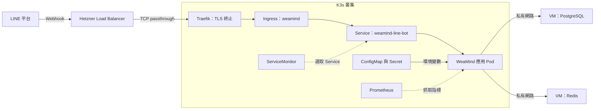
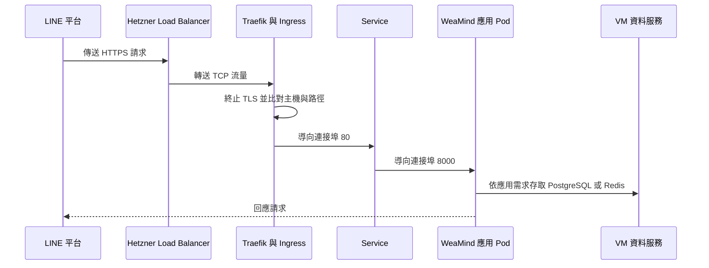
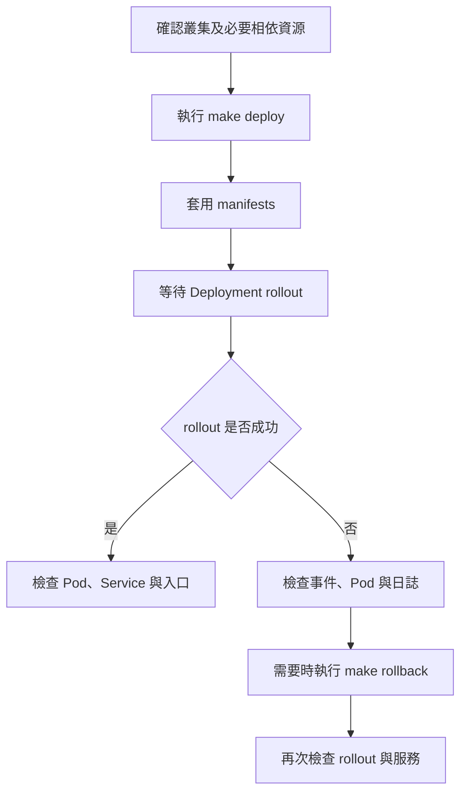
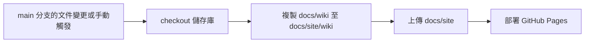

# WeaMind 基礎設施

weamind-infra 管理 WeaMind LINE Bot 的 Kubernetes 部署設定，並保存監控、故障演練與基礎設施即程式碼的學習資產。WeaMind 應用程式由獨立的 [weamind 儲存庫](https://github.com/kyomind/weamind)負責；本儲存庫描述映像檔如何在 K3s 中執行、接收流量及連接既有資料服務。以下設定反映儲存庫中的宣告，實際叢集狀態仍須以現場查詢為準。

## 系統架構與責任邊界

K3s 應用層與 VM 資料層以私有網路連接。公開流量經 Hetzner Load Balancer 的 TCP passthrough 進入 Traefik，由 Traefik 終止 TLS 並轉送至應用。PostgreSQL 與 Redis 保留在原 VM；單機版與 K8s 版使用不同網址，可透過 LINE webhook URL 切換入口。



圖中的監控路徑取決於 Prometheus 是否選取該 ServiceMonitor，及目標是否可達。架構依據為 `README.md`、`docs/WeaMind Infra核心架構.md` 與 `manifests/`；這些宣告本身不證明外部基礎設施目前的運作狀態。

## Kubernetes 資源與流量

| 資源 | 設定與責任 | 來源 |
| --- | --- | --- |
| Namespace | `weamind` 是應用資源的命名空間。 | `manifests/namespace.yaml` |
| Deployment | `weamind` 宣告兩個副本，Pod 使用 `app: weamind` 標籤，並排程至 `nodepool: worker` 的節點。 | `manifests/deployment.yaml` |
| Service | `weamind-line-bot` 是 ClusterIP Service，以 `app: weamind` 選取 Pod，將連接埠 80 導向 8000。 | `manifests/service.yaml` |
| Ingress | `weamind` 使用 `traefik` 類別，將 `k8s.kyomind.tw` 的 `/` 前綴導向 Service 的 80 連接埠。 | `manifests/ingress.yaml` |
| Middleware | `https-redirect` 設定永久 HTTPS 轉址，由 Ingress 的 Traefik 註記引用。 | `manifests/middleware-https-redirect.yaml` |
| ServiceMonitor | 選取 `weamind` 命名空間中帶有 `app: weamind` 的 Service，設定指標抓取端點。 | `manifests/service-monitor.yaml` |
| PodDisruptionBudget | `weamind` 要求至少一個符合 `app: weamind` 的 Pod 可用。 | `manifests/pdb.yaml` |
| NetworkPolicy | 入站允許 Traefik 與 Prometheus 連至 TCP 8000；出站允許 DNS、指定資料服務及公網 HTTPS。 | `manifests/networkpolicy-ingress.yaml`、`manifests/networkpolicy-egress.yaml` |

Ingress 引用 TLS Secret `k8s-kyomind-tw-tls`；憑證發行與維護依賴叢集中的 cert-manager、DNS 驗證及相關設定，並非由這些應用 manifests 完整定義。應用流量從 Service 導向符合 selector 且可用的 Pod；若 Pod 未通過 readiness probe，應檢查端點與健康狀態。



HTTPS 轉址由 Traefik Middleware 宣告；是否能收到 HTTP 請求並執行轉址，仍取決於外部負載平衡器與入口設定。

## 應用執行與設定

`manifests/deployment.yaml` 宣告使用 `ghcr.io/kyomind/weamind:1.3.0`，拉取策略為 `Always`。容器以 `uvicorn app.main:app` 監聽 `0.0.0.0:8000`，啟用 `--proxy-headers`、`uvloop` 與 `httptools`，並設定一個 worker；擴展依靠副本數，避免多個 worker 分別計算 in-memory metrics。每個容器的 CPU 和記憶體 requests 分別為 `250m`、`256Mi`，limits 為 `1000m`、`768Mi`。

Deployment 不自動掛載 ServiceAccount token，並以 hostname 拓撲分散同一 ReplicaSet 的 Pod；無法符合分散條件時，Pod 保持 Pending。

Deployment 透過 `envFrom` 注入兩個同命名空間資源：

- `weamind-config`：非敏感設定，包括 `ENV=production`、`BASE_URL`、PostgreSQL 與 Redis 位址，以及 `PROCESSING_LOCK_TTL_SECONDS=2`。目前宣告的 PostgreSQL 位址為 `10.0.0.2:5433`，Redis 為 `redis://10.0.0.2:6379/0`；見 `manifests/configmap.yaml`。
- `weamind-secret`：應用敏感設定的來源，必須另外提供；Deployment 只引用它，未在所列應用 manifests 中定義其內容。

這些值作為容器環境變數載入；更新 ConfigMap 或 Secret 後，已執行容器的環境變數不會自動更新，需安排 Pod 重新建立。敏感值應放在 Secret，不應寫入 ConfigMap。

### 健康檢查與指標

readiness 與 liveness probe 都對容器的 `http` 連接埠請求 `/health`。readiness 初始延遲 5 秒、每 10 秒檢查；liveness 初始延遲 15 秒、每 20 秒檢查。前者影響 Pod 是否接收 Service 流量，後者失敗則可能觸發容器重啟。

`ServiceMonitor` 使用 Service 的具名連接埠 `http`，以 HTTP 抓取 `/metrics`，間隔 30 秒、逾時 10 秒；其 `release: watchmind` 標籤也必須符合 Prometheus 的選取設定。ServiceMonitor CRD 及監控控制器是外部前置條件。來源：`manifests/deployment.yaml`、`manifests/service.yaml`、`manifests/service-monitor.yaml`。

`helm/watchmind-values.yaml` 將 Grafana RBAC 限於命名空間，並將 dashboard sidecar 的 `searchNamespace` 設為 `null`。

## 部署與操作

`Makefile` 提供以下操作，執行時使用目前 `kubectl` context 所指向的叢集：

| 指令 | 行為 |
| --- | --- |
| `make deploy` | 執行 `kubectl apply -f manifests/`，接著等待 `weamind` Deployment rollout 狀態。 |
| `make rollout` | 查詢並等待同一 Deployment 的 rollout 狀態。 |
| `make rollback` | 對該 Deployment 執行 `kubectl rollout undo`。 |
| `make update-prompt-index` | 從各 prompt 的 `description:` 產生 `.github/prompts/index.md`。 |

`make deploy` 會一併套用入站與出站 NetworkPolicy；出站政策檔案註明應先確認入站政策正常，再於離峰時段單獨套用出站政策並用 LINE 實測。

首次部署前須確認 Namespace、`weamind-secret`、TLS Secret、Traefik Middleware CRD 與 ServiceMonitor CRD 等相依資源已可用；`make deploy` 沒有建立 Secret 或安裝控制器的步驟。README 的部署概覽列出資源準備順序。若是全新叢集，應先建立 Namespace 與必要相依資源，再套用其餘資源。Deployment rollback 處理的是 Deployment 的修訂，不會一併回復 ConfigMap、Secret、Ingress 或外部資料。



常用診斷起點如下；外部連線與應用資料庫存取仍需分別驗證：

```bash
kubectl get pods,svc,ingress -n weamind
kubectl describe deployment weamind -n weamind
kubectl get events -n weamind --sort-by=.lastTimestamp
kubectl logs -n weamind -l app=weamind
kubectl rollout status deployment/weamind -n weamind
```

## Darkmind 故障演練

`darkmind/` 是獨立的 Kubernetes 故障排除練習，不連接正式 WeaMind、LINE webhook 或資料服務。其 `darkmind` Namespace 與正式應用分開。基準資源 `darkmind/healthy.yaml` 建立一個使用 `nginx:1.27-alpine` 的單副本 Deployment，以及以 `app: darkmind-healthy` 選取 Pod 的 ClusterIP Service；兩種 probe 均檢查 `/`。

`darkmind/scenarios/` 提供映像檔拉取失敗、容器反覆退出、readiness 失敗及 rollout 卡住等練習。建立順序、各情境操作與清理方式見 `darkmind/README.md`；這些資源不包含在 `make deploy` 的 `manifests/` 套用範圍中。

## 應用容器與工作流程參考

`references/Dockerfile` 以 uv 安裝鎖定的正式相依套件，再複製應用程式碼。`references/docker-compose.yml` 定義 app、PostgreSQL 與 Redis，使用外部 `wea-net`；`references/docker-compose.prod.yml` 加上正式環境啟動指令、重新啟動策略及資料磁碟區。這些是應用端參考設定。

`references/Makefile` 提供 Compose 的 `dev-up`、`clean`、`setup-prod`、`up`、`down` 與 `deploy`，以及 Alembic 的 `migrate`、`revision`、`rollback`。其中 `deploy` 等待資料庫後執行遷移，遷移失敗時輸出警告。

`references/weamind-app-ci.yml` 描述應用程式的品質檢查、測試與映像檔建置驗證；`references/weamind-app-publish-ghcr.yml` 在 main 分支的 push 通過 CI 後發布 `latest` 與 SHA 標籤，`references/weamind-app-publish-release.yml` 在 `v*` tag 推送時發布版本標籤。這些檔案是應用儲存庫工作流程的參考。

`.github/workflows/release.yml` 則在本儲存庫推送 `v*` tag 時，擷取 `CHANGELOG.md` 對應版本的非空段落，並建立 GitHub Release。

## Terraform 與文件發布

`terraform/` 保存獨立的 GCP VM 練習：`gcp-free-tier-vm/` 著重最小 Terraform 工作流程，`gcp-e2-micro-tw/` 著重台灣區 VM 與成本邊界。兩者不是目前 WeaMind K3s 應用部署的入口；詳細設定與操作見各目錄的 `README.md`。

`.github/workflows/pages.yml` 的 `deploy` job 發布靜態文件：`main` 分支中 `docs/site/**` 或 `docs/wiki/**` 變更時，或手動觸發時，工作流程先 checkout，將 `docs/wiki` 複製至 `docs/site/wiki`，再上傳 `docs/site` 並部署至 GitHub Pages。`pages` concurrency group 會取消進行中的舊執行；此流程不部署 Kubernetes 應用。



`skills-lock.json` 記錄 `stack-diagram` skill 的來源、路徑與雜湊，屬於文件製作工具的鎖定資訊，與應用執行時設定無關。

## 延伸資料

- `README.md`：整體架構、部署概覽與設計取捨。
- `docs/WeaMind Infra核心架構.md`：混合架構與網路責任。
- `PROGRESS.md`：實作進度與故障紀錄。
- `darkmind/README.md`：演練情境與指令。
- `terraform/README.md`：Terraform 資產範圍。
- [WeaMind 應用儲存庫](https://github.com/kyomind/weamind)：應用程式與其業務邏輯。
